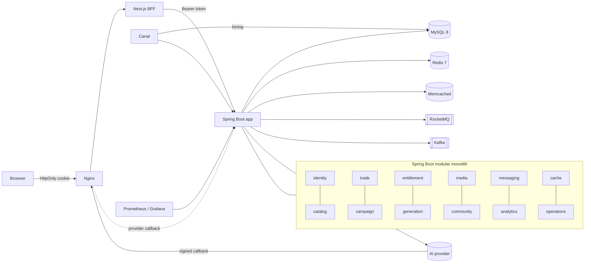

<div align="center">


# Tessera AI Platform

**An AI creation platform where flash-sale credit packs meet fair-scheduled image generation.**

English · [简体中文](README.zh-CN.md)

<p>
  <a href="LICENSE"></a>
  
</p>
<p>
  
  
  
  
  
  
  
</p>
<p>
  
  
  
  
  
  
</p>
<p>
  
  
  
  
  
  
</p>

[Overview](#overview) ·
[Highlights](#highlights) ·
[Architecture](#architecture) ·
[Benchmarks](#benchmarks) ·
[Quick Start](#quick-start) ·
[Project Layout](#project-layout) ·
[Limitations](#known-limitations) ·
[License](#license)

</div>

---

## Overview

> *Tessera* (Latin): a token that granted entry in ancient Rome, and also a single tile of a mosaic.
> In Tessera, credits are the tokens, and every generated image is a tile.

Tessera is a **modular monolith** (Spring Boot plus a Next.js BFF) for AI creators. Users discover AI apps, buy regular or **limited flash-sale credit packs**, spend those credits on **image generation tasks**, and share the results with the community.

It is built around two flagship flows, and each one is meant to stay correct under concurrency and failure:

| Flow | What has to stay correct |
| --- | --- |
| **Limited credit trading** | High-concurrency flash sales with no overselling, async order creation, payment vs. expiry races, stock release, reliable messaging and reconciliation |
| **Credit consumption → AI fulfillment** | Concurrent quota freezing, request idempotency, fair task scheduling, upstream result reconciliation, private delivery and exactly-once settlement |

The goal is a project you can **clone, run on a single machine and evaluate**: one command brings up the full stack, demo data and a simulated upstream. A real provider (SiliconFlow Kolors) can be plugged in for actual image output.

## Highlights

### 🎯 Fair scheduling across users
A naive FIFO queue lets one heavy user who submits 100 tasks starve everyone else. Tessera picks the user with the lowest **in-flight tasks ÷ weight** for each free slot, and claims only that handoff row with `FOR UPDATE SKIP LOCKED`.
→ Light-user P95 queue wait drops from **62.5 s to 1.8 s** with unchanged total throughput. A 3:1 weight yields a **3.03** completion ratio.

### 📉 AIMD adaptive concurrency with safe 429 requeue
Concurrency toward each provider follows TCP-style **AIMD**. A `429` halves the limit and pauses, and full utilization with a backlog adds +1 every 5 s. A `429` is never treated as a failure: the task goes back to the queue, the frozen credit stays put, and the retry reuses the same `attempt_key`, so the upstream sees at most one job. Timeouts are *not* requeued; they go to reconciliation.
→ With upstream capacity 8, the throttled ratio falls from **61 % (fixed 16) to 1.2 %**, at **+26 %** throughput over a fixed 4.

### 🧾 Ledger-grade credit accounting
Credits move through **freeze → consume / release**, with an append-only ledger and unique keys on every entry. Terminal side effects have a single entry point guarded by a conditional state transition, so repeated callbacks or polls can never settle twice. Results are downloaded, type-checked, hashed and stored privately *before* the freeze turns into consumption.
→ **28 accounting invariants** and a **9-scenario fault matrix** (crash, timeout, duplicate callback, lost response, …) pass after every experiment.

### ⚡ Flash sale without overselling
Redis-coordinated limited campaigns with async order creation through Redis Stream or a transactional outbox, a payment-vs-close race on a single order row lock, and stock returned on expiry.
→ Open-loop **400 RPS at 0 % errors, P99 ≈ 58 ms**. A sold-out probe with 1,000 units yields **exactly 1,000 orders**.

### 📬 Reliable messaging and CDC
Transactional **outbox → RocketMQ** with an inbox for deduplication, leased relays and backoff. **Canal** binlog CDC invalidates caches when data is changed directly in the database. **Kafka** carries behavior analytics and the trending-apps ranking, and the app keeps working when any broker is down.

### 🗄️ Five-layer cache
Request scope → Caffeine → Memcached → Redis → MySQL. Rebuilds use a lock with owner checks and Lua version guards, so stale values are never written back. Invalidation is per key over Pub/Sub, and when Redis or Memcached fails, reads degrade with bounded fallback concurrency instead of flooding the database.

### 🔍 Deadlocks found and fixed with evidence
Real InnoDB deadlocks were traced with `performance_schema.data_locks` and fixed at the root:
- A foreign-key-backing index that included a status column made every status update take a shared lock on the parent row. After narrowing the index, deadlocks of that kind went to **0**.
- An outbox relay that locked the whole backlog every second, gap locks that blocked new event inserts, and a lock-upgrade order in stock release were all fixed. With 20,000 expiring orders, order creation went from **~32 to 38–42 orders/s**, Redis stock re-aligned **62 s** after close (it was still 6,021 units behind after 35 min), and deadlocks went from **107 to 0**.

### 🌐 BFF frontend that respects private resources
Next.js server components act as a BFF that keeps the token in an **HttpOnly cookie** and checks request origin to block CSRF. Public pages render dynamically with `no-store`, so unpublishing takes effect immediately (no stale ISR or image-optimizer copies). The UI states clearly when a result is unknown and lets the user recover the original task without freezing credits twice.

### 🛠️ Operable on one machine
Isolated per-environment Compose projects, least-privilege DB accounts (the app never uses root), Flyway with clean disabled, pinned image digests, non-root containers, loopback-only ports, Prometheus + Grafana + Alertmanager, and backup / restore / rollback scripts.

## Architecture



**Life of a generation task**

1. **Submit**: one transaction writes the request key, freezes 1 credit, and creates the task, the handoff row and a queue slot. Any failure rolls back all of it.
2. **Dispatch**: a scheduler fills free slots by fairness, locks one handoff row and creates an attempt with an `attempt_key`. No network I/O happens inside this transaction.
3. **Submit upstream**: the request is sent after commit. Accepted means polling, explicit rejection means fail and release, `429` means requeue, and an ambiguous outcome goes to reconciliation.
4. **Converge**: polling or a signed callback moves the attempt to a terminal state and frees the in-flight slot.
5. **Deliver and settle**: the result is downloaded, validated and stored privately. Only then does the freeze become consumption.

## Benchmarks

> All numbers come from **local experiments on a single Docker host** with one app instance. Generation experiments use the simulated upstream. Flash-sale load tests used app 4C/3G, MySQL 2C/2G and Redis 1C/512M. Each figure is the median of 3 runs. **These are not production capacity claims.**

**Fair scheduling**: a heavy user submits 100 tasks while light users keep submitting.

| Metric | FIFO | Fair |
| --- | ---: | ---: |
| Light-user queue wait P95 | 62.5 s | **1.8 s** |
| Total throughput | ~1.5 tasks/s | ~1.5 tasks/s |
| Heavy-user completion time | baseline | +32 % |
| Completion ratio at weight 3:1 | n/a | **3.03** |

**Adaptive concurrency**: upstream capacity 8.

| Mode | Throttled (429) ratio | Notes |
| --- | ---: | --- |
| Fixed 16 | 61 % | Higher raw throughput in simulation only, because simulated 429s cost nothing |
| Fixed 4 | low | Under-uses capacity |
| **AIMD** | **1.2 %** | +26 % throughput vs. fixed 4. When capacity drops 8 → 3 it backs off in ~3 s, and it recovers to 6 in ~10 s |

**Flash sale and order expiry**

| Scenario | Result |
| --- | --- |
| Campaign entry, open-loop 400 RPS | 0 % errors, P99 ≈ 58 ms |
| Sold-out probe, stock 1,000 | exactly 1,000 orders, zero oversell |
| 20,000 orders expiring at once (after fixes) | 38–42 orders/s; Redis stock aligned 62 s after close; 0 deadlocks (was 107) |

**Correctness and real-provider validation**

- 28 accounting invariants (for example *frozen credits = unsettled tasks*, *channel counters = actual in-flight*) are checked after every run.
- 9 fault scenarios are regression-tested: process crash, upstream timeout, duplicate and conflicting callbacks, lost responses, quota exhaustion and more.
- 68 real calls to SiliconFlow covered the page-to-image flow, a requeue after a real 429 and a credit release after an upstream rejection. They also caught 3 bugs the simulator could not: a 1,575-char signed URL that overflowed a 512-char column, a PNG served as `application/octet-stream`, and a media quota that held only 25 real images.

## Quick Start

### Prerequisites

- **Docker Desktop** (Compose v2)
- **JDK 21** (Temurin recommended). Set `JAVA_HOME` or `AI_PLATFORM_JAVA_HOME`.
- **PowerShell 7** recommended. The scripts are written and tested on Windows.
- Node.js is **not** required for the full stack, because the frontend builds inside Docker.

### Run the demo

```powershell
git clone https://github.com/zaughterCoding/Tessera-AI-Platform.git
cd Tessera-AI-Platform

.\deploy\init-env.ps1 -Environment demo -Demo   # generates random credentials into .local/
.\deploy\start.ps1    -Environment demo         # builds and starts the whole stack
.\deploy\seed-demo.ps1 -Environment demo        # loads demo apps, creators and works
```

Open **http://127.0.0.1:18480/**. In demo mode the login verification code is shown on the page.

| Account (phone) | Role |
| --- | --- |
| `13800000000` | Admin (operations console) |
| `13800000001` – `13800000003` | Creators with existing works |
| any other number | Auto-registered new user. Use it to walk the full flow |

### A 3-minute tour

1. Log in with a new phone number, open `/apps/1`, buy the starter pack and pay with the **simulated** payment. You will see payment and credit delivery update as two separate steps.
2. Go to the creation page and submit. The task page shows **1 credit frozen**.
3. When the task completes, the image appears and the credit becomes **consumed**.
4. Publish the result as a work and open it in a private window. Unpublish it, and the page and image return 404 immediately.
5. Optional: turn the network offline in DevTools and submit. The UI reports *result unknown*. Go back online, recover the original task, and confirm that only one credit was frozen.
6. Log in as `13800000000` to see campaign reconciliation and cache read-path tracing.

To stop the stack (data volumes are kept):

```powershell
.\deploy\stop.ps1 -Environment demo
```

### Real image generation (optional)

Without any configuration, the built-in simulated provider handles every task. To route tasks to SiliconFlow Kolors, add the following to your git-ignored `.local/deploy/<env>/.env` and restart:

```dotenv
APP_GENERATION_CHANNEL_CODE=http-image
APP_GENERATION_HTTP_ENABLED=true
APP_GENERATION_HTTP_PROTOCOL=siliconflow
APP_GENERATION_HTTP_BASE_URL=https://api.siliconflow.cn
APP_GENERATION_HTTP_SUBMIT_PATH=/v1/images/generations
APP_GENERATION_HTTP_MODEL=Kwai-Kolors/Kolors
APP_GENERATION_HTTP_API_KEY=<your key>
APP_GENERATION_HTTP_REAL_CALL_LIMIT=5          # hard cap on real calls; start small
APP_GENERATION_HTTP_REQUEST_TIMEOUT_MS=90000
APP_GENERATION_LEASE_SECONDS=150               # must be longer than the request timeout
APP_GENERATION_CHANNEL_MAX_IN_FLIGHT=1
APP_GENERATION_ADAPTIVE_INITIAL_IN_FLIGHT=1
```

You may also need to add the provider's result host to `APP_GENERATION_RESULT_ALLOWED_HOSTS`. **Never commit the env file or your API key.**

### Development

```powershell
# Backend: Checkstyle + compile + package -> target/ai-creation-platform.jar
.\dev\build.ps1            # or: ./mvnw -DskipTests package

# Isolated dev environment (dev | test | load), app on http://127.0.0.1:18080
.\dev\init-env.ps1 -Environment dev
.\dev\start.ps1    -Environment dev

# Frontend only (Node 24)
cd web
npm ci
$env:API_ORIGIN = 'http://127.0.0.1:18080'
npm run dev
```

Health endpoints: `/actuator/health`, `/actuator/health/liveness` and `/actuator/health/readiness`. Readiness covers MySQL and Redis only, so the app stays up when a broker or Canal is down.

## Project Layout

```text
.
├── src/main/java/com/aiplatform
│   ├── identity      # phone login, sessions, roles
│   ├── catalog       # AI apps and credit products
│   ├── cache         # five-layer cache and invalidation
│   ├── trade         # orders, simulated payment, expiry
│   ├── campaign      # limited flash-sale campaigns
│   ├── entitlement   # credit grants, balances, ledger
│   ├── generation    # tasks, fair scheduler, AIMD, providers, settlement
│   ├── media         # private media storage and quotas
│   ├── community     # works, likes, follows, feed, sign-in
│   ├── messaging     # outbox / inbox and RocketMQ relay
│   ├── analytics     # Kafka behavior events, trending apps
│   ├── operations    # admin audit, retention
│   └── experience    # demo and showcase endpoints
├── src/main/resources/db/migration   # Flyway SQL (versioned, never edited once applied)
├── web/              # Next.js 16 + React 19 BFF frontend
├── deploy/           # self-contained delivery: Compose, Nginx, monitoring, backup/restore
├── dev/              # isolated dev / test / load environments
└── config/           # Checkstyle rules
```

## Known Limitations

- **Single instance.** The scheduler's re-entrancy guard is in-process, so multi-instance deployment is not supported.
- Fairness counts tasks, not output images. AIMD reacts only to `429` and ignores latency, timeouts and 5xx.
- If a synchronous real-provider response is lost, the task stays frozen for **manual reconciliation**. It is never auto-resubmitted or auto-refunded, which is the safe trade-off against double charging.
- Payment is **simulated** and clearly labeled. There is no real payment channel.
- DNS rebinding protection for result downloads is a documented security boundary and is not yet implemented.
- With fair scheduling disabled, dispatch and submit can deadlock. The transaction rolls back and the task is reclaimed on the next scan. Fair scheduling is on by default.
- All performance figures are from a single local Docker host.

## Acknowledgements

Built with Spring Boot, MyBatis-Plus, Hutool, Apache RocketMQ, Apache Kafka, Alibaba Canal, Next.js, TanStack Query, Radix UI, Tailwind CSS and lucide icons. Each dependency keeps its own license.

## License

Released under the [MIT License](LICENSE). © 2026 Haokun Zheng.

<div align="center">
<sub>Made by <a href="https://github.com/zaughterCoding">Haokun Zheng</a> · If this project helps you, a ⭐ is appreciated.</sub>
</div>
