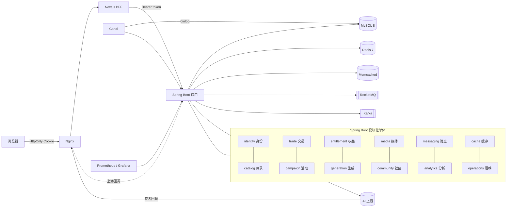

<div align="center">


# Tessera AI Platform

**限量权益抢购 × 公平调度的 AI 图片生成，一个可在单机跑通、可评测的 AI 创作平台。**

[English](README.md) · 简体中文

<p>
  <a href="LICENSE"></a>
  
</p>
<p>
  
  
  
  
  
  
  
</p>
<p>
  
  
  
  
  
  
</p>
<p>
  
  
  
  
  
  
</p>

[项目简介](#项目简介) ·
[核心亮点](#核心亮点) ·
[系统架构](#系统架构) ·
[评测数据](#评测数据) ·
[快速开始](#快速开始) ·
[目录结构](#目录结构) ·
[已知限制](#已知限制) ·
[开源协议](#开源协议)

</div>

---

## 项目简介

> *Tessera*（拉丁语）：古罗马的入场凭证，也是马赛克中的一块小瓷砖。
> 在 Tessera 里，权益是凭证，每一张生成的图片都是一块瓷砖。

Tessera 是一个面向 AI 创作者的**模块化单体**项目（Spring Boot 后端 + Next.js BFF 前端）。用户浏览 AI 应用，购买普通权益包或**抢购限量补贴包**，用权益提交**图片生成任务**，再把作品分享到社区。

项目围绕两条旗舰业务链路，每一条都要求在并发和故障下保持正确：

| 链路 | 需要保证的正确性 |
| --- | --- |
| **限量权益交易** | 高并发抢购防超卖、异步建单、支付与到期关单竞争、库存释放、可靠消息与对账 |
| **权益消费 → AI 任务履约** | 并发冻结、请求幂等、公平调度、上游结果核对、私有交付、只结算一次 |

目标是让任何人都能 **clone 下来、在单机运行并评测**：一条命令拉起完整服务栈、演示数据和模拟上游；也可以接入真实渠道（SiliconFlow Kolors）实际出图。

## 核心亮点

### 🎯 用户间公平调度
先来先服务时，一个大户一次提交 100 个任务，其他人都得排在后面。Tessera 每有一个空位，就选“**在途任务数 ÷ 权重**”最小的用户，再用 `FOR UPDATE SKIP LOCKED` 只锁那一行交接记录。
→ 小户排队 P95 从 **62.5 秒降到 1.8 秒**，总吞吐不变；权重 3:1 时实际完成比 **3.03**。

### 📉 AIMD 自适应并发 + 429 安全重排
对每个上游的并发按 TCP 风格的 **AIMD** 调整：收到 `429` 立即减半并暂停；空位用满且仍有排队时每 5 秒加 1。`429` 不算失败：任务回到队列，冻结不动，复用同一 `attempt_key` 重提，上游最多只有一个任务。超时则*不*重排，转入核对。
→ 上游容量为 8 时，限流比例从固定 16 并发的 **61% 降到 1.2%**，吞吐比固定 4 并发高 **26%**。

### 🧾 账本级的权益记账
权益按 **冻结 → 消费 / 释放** 三步流转，流水只追加，且每条都有唯一键。终态副作用只有一个入口，由条件状态迁移把关，重复的回调或轮询不可能结算两次。结果先下载、校验类型、计算摘要并存入私有媒体库，之后冻结才转为消费。
→ **28 项账务不变量**和 **9 类故障矩阵**（进程崩溃、超时、重复回调、响应丢失等）每轮实验后都回归通过。

### ⚡ 零超卖的限量抢购
限量活动由 Redis 协调，异步建单走 Redis Stream 或事务 Outbox；支付与关单在同一订单行锁上竞争；订单到期后归还库存。
→ 开环 **400 RPS 错误率 0、P99 约 58 ms**；售罄探针库存 1000 正好成交 **1000 单**。

### 📬 可靠消息与 CDC
事务 **Outbox → RocketMQ**，配合 Inbox 去重、租约中继与退避重试。**Canal** 订阅 binlog，直接改库也能让缓存失效。**Kafka** 承载行为分析与应用热榜。任一 Broker 宕机，应用都能继续工作。

### 🗄️ 五层缓存
请求作用域 → Caffeine → Memcached → Redis → MySQL。重建时用带 owner 校验的锁和 Lua 版本保护，旧值不会被回填。失效按 Key 通过 Pub/Sub 下发。Redis 或 Memcached 故障时，读请求以有界回源并发降级，不会把数据库打穿。

### 🔍 用证据定位并修复死锁
用 `performance_schema.data_locks` 追踪真实的 InnoDB 死锁，并从根上修复：
- 外键依托的索引包含状态列，导致每次改状态都对父行加共享锁。缩小索引后，这一类死锁降为 **0**。
- 中继每秒锁住全部积压行、认领的间隙锁挡住新事件写入、库存归还时锁升级顺序不当，这三处都已修复。2 万单集中到期时，建单从约 **32 单/秒升到 38～42 单/秒**；修复前 Redis 库存 35 分钟后仍落后 6021 件，修复后关单 **62 秒**内对齐；死锁从 **107 次降到 0**。

### 🌐 守住私有资源的 BFF 前端
Next.js 服务端组件作为 BFF，令牌放在 **HttpOnly Cookie**，并校验写请求来源以防 CSRF。公开页 `no-store` 动态渲染，取消发布立即生效，不会残留 ISR 或图片优化缓存。响应丢失时，界面明确提示“结果未知”，并能找回原任务而不重复冻结。

### 🛠️ 单机即可运维
每个环境使用独立的 Compose 项目；数据库账户最小权限，应用不用 root；Flyway 禁用 clean；镜像固定 digest，容器以非 root 用户运行，端口只绑定回环地址；配套 Prometheus + Grafana + Alertmanager，以及备份、恢复、回滚脚本。

## 系统架构



**一次生成任务的全流程**

1. **提交**：同一事务里写请求键、冻结 1 次额度，并创建任务、交接行和排队名额。任何一步失败全部回滚。
2. **调度**：调度器按公平规则填充空位，锁住一行交接记录，创建带 `attempt_key` 的尝试。这个事务内不做网络调用。
3. **提交上游**：事务提交后才发请求。上游接受就进入轮询；明确拒绝就失败并释放；`429` 就重排；结果说不清时转入核对。
4. **收敛**：轮询或签名回调把尝试改为终态，并释放在途名额。
5. **交付与结算**：下载结果、校验后私有存储，之后冻结才转为消费。

## 评测数据

> 所有数字都来自**单台 Docker 主机上的本地实验**，只跑一个应用实例。生成类实验使用模拟上游；抢购压测配置为应用 4C/3G、MySQL 2C/2G、Redis 1C/512M。每项取 3 轮中位数。**这些数字不代表生产容量。**

**公平调度**：大户提交 100 个任务，小户同时持续提交。

| 指标 | 先来先服务 | 公平调度 |
| --- | ---: | ---: |
| 小户排队等待 P95 | 62.5 秒 | **1.8 秒** |
| 总吞吐 | 约 1.5 个/秒 | 约 1.5 个/秒 |
| 大户完成用时 | 基准 | +32% |
| 权重 3:1 时的完成比 | — | **3.03** |

**自适应并发**：上游容量为 8。

| 模式 | 限流（429）比例 | 说明 |
| --- | ---: | --- |
| 固定 16 | 61% | 只有在模拟环境里原始吞吐更高，因为模拟的 429 没有代价 |
| 固定 4 | 低 | 容量用不满 |
| **AIMD** | **1.2%** | 吞吐比固定 4 高 26%；容量从 8 降到 3 时约 3 秒退下来，约 10 秒恢复到 6 |

**抢购与到期关单**

| 场景 | 结果 |
| --- | --- |
| 活动入口，开环 400 RPS | 错误率 0，P99 约 58 ms |
| 售罄探针，库存 1000 | 正好 1000 单，零超卖 |
| 2 万单集中到期（修复后） | 38～42 单/秒；关单后 62 秒 Redis 库存对齐；死锁 0（修复前 107） |

**正确性与真实渠道验证**

- 每轮实验后检查 28 项账务不变量，例如“冻结额 = 未结算任务数”“渠道计数 = 实际在途数”。
- 9 类故障场景回归：进程崩溃、上游超时、重复与冲突回调、响应丢失、配额耗尽等。
- 对 SiliconFlow 累计 68 次真实调用，走通了页面到出图、真实 429 后重排成功、上游拒绝后释放冻结；还发现并修复了 3 个模拟环境测不出的问题：签名地址长达 1575 字符，超出 512 的列宽；PNG 被声明为 `application/octet-stream`；媒体配额只够存 25 张真实图片。

## 快速开始

### 环境要求

- **Docker Desktop**（Compose v2）
- **JDK 21**（推荐 Temurin），设置 `JAVA_HOME` 或 `AI_PLATFORM_JAVA_HOME`
- 推荐 **PowerShell 7**；脚本在 Windows 上编写并测试
- 跑完整服务栈**不需要** Node.js，前端在 Docker 内构建

### 运行演示

```powershell
git clone https://github.com/zaughterCoding/Tessera-AI-Platform.git
cd Tessera-AI-Platform

.\deploy\init-env.ps1 -Environment demo -Demo   # 在 .local/ 下生成随机凭据
.\deploy\start.ps1    -Environment demo         # 构建并启动完整服务栈
.\deploy\seed-demo.ps1 -Environment demo        # 导入演示应用、创作者和作品
```

打开 **http://127.0.0.1:18480/**。演示模式下，登录验证码直接显示在页面上。

| 账号（手机号） | 角色 |
| --- | --- |
| `13800000000` | 管理员（运营台） |
| `13800000001` ～ `13800000003` | 已有作品的创作者 |
| 其他任意号码 | 自动注册的新用户，适合走完整流程 |

### 三分钟体验

1. 用新手机号登录，打开 `/apps/1`，购买入门包并用**模拟支付**付款，可以看到“支付完成”和“权益到账”分两步变化。
2. 进入创作页提交任务，任务页显示**冻结 1 次**。
3. 任务完成后出现结果图，权益变为**已消费**。
4. 把结果发布为作品，在无痕窗口打开；取消发布后，详情页和图片立即返回 404。
5. 可选：在 DevTools 中把网络切到离线再提交，界面提示“结果未知”；恢复网络后找回原任务，确认只冻结了一次。
6. 用 `13800000000` 登录，查看活动对账和缓存读路径追踪。

停止服务（保留数据卷）：

```powershell
.\deploy\stop.ps1 -Environment demo
```

### 接入真实出图（可选）

不做任何配置时，所有任务都由内置的模拟渠道处理。要把任务路由到 SiliconFlow Kolors，在被 git 忽略的 `.local/deploy/<env>/.env` 中加入以下配置后重启：

```dotenv
APP_GENERATION_CHANNEL_CODE=http-image
APP_GENERATION_HTTP_ENABLED=true
APP_GENERATION_HTTP_PROTOCOL=siliconflow
APP_GENERATION_HTTP_BASE_URL=https://api.siliconflow.cn
APP_GENERATION_HTTP_SUBMIT_PATH=/v1/images/generations
APP_GENERATION_HTTP_MODEL=Kwai-Kolors/Kolors
APP_GENERATION_HTTP_API_KEY=<你的 Key>
APP_GENERATION_HTTP_REAL_CALL_LIMIT=5          # 真实调用上限，从小开始
APP_GENERATION_HTTP_REQUEST_TIMEOUT_MS=90000
APP_GENERATION_LEASE_SECONDS=150               # 必须长于请求超时
APP_GENERATION_CHANNEL_MAX_IN_FLIGHT=1
APP_GENERATION_ADAPTIVE_INITIAL_IN_FLIGHT=1
```

可能还需要把上游的结果地址域名加入 `APP_GENERATION_RESULT_ALLOWED_HOSTS`。**环境文件和 API Key 不要提交到 Git。**

### 本地开发

```powershell
# 后端：Checkstyle + 编译 + 打包 -> target/ai-creation-platform.jar
.\dev\build.ps1            # 或：./mvnw -DskipTests package

# 独立开发环境（dev | test | load），应用地址 http://127.0.0.1:18080
.\dev\init-env.ps1 -Environment dev
.\dev\start.ps1    -Environment dev

# 只开发前端（Node 24）
cd web
npm ci
$env:API_ORIGIN = 'http://127.0.0.1:18080'
npm run dev
```

健康检查：`/actuator/health`、`/actuator/health/liveness`、`/actuator/health/readiness`。就绪检查只包含 MySQL 和 Redis，所以 Broker 或 Canal 宕机时应用仍然可用。

## 目录结构

```text
.
├── src/main/java/com/aiplatform
│   ├── identity      # 手机号登录、会话、角色
│   ├── catalog       # AI 应用与权益商品
│   ├── cache         # 五层缓存与失效
│   ├── trade         # 订单、模拟支付、到期关单
│   ├── campaign      # 限量抢购活动
│   ├── entitlement   # 权益发放、余额、流水
│   ├── generation    # 任务、公平调度、AIMD、上游渠道、结算
│   ├── media         # 私有媒体存储与配额
│   ├── community     # 作品、点赞、关注、Feed、签到
│   ├── messaging     # Outbox / Inbox 与 RocketMQ 中继
│   ├── analytics     # Kafka 行为事件、应用热榜
│   ├── operations    # 管理审计、数据保留
│   └── experience    # 演示与技术体验接口
├── src/main/resources/db/migration   # Flyway SQL（按版本追加，已应用的不修改）
├── web/              # Next.js 16 + React 19 BFF 前端
├── deploy/           # 独立交付：Compose、Nginx、监控、备份恢复
├── dev/              # 隔离的 dev / test / load 环境
└── config/           # Checkstyle 规则
```

## 已知限制

- **单实例运行**：调度器的防重入在进程内实现，不支持多实例部署。
- 公平调度按任务数计算，不按输出张数；AIMD 只对 `429` 做出反应，不看延迟、超时和 5xx。
- 真实渠道的同步响应丢失时，任务保持冻结、等待**人工核对**，不自动重提也不自动退款，以避免重复扣费。
- 支付为**模拟支付**并有明确标识，没有接入真实支付渠道。
- 结果下载的 DNS 重绑定防护是已记录的安全边界，尚未实现。
- 关闭公平调度时，派发和提交之间可能死锁：事务回滚，任务在下次扫描时重新认领，数据不受影响。默认开启公平调度。
- 所有性能数字都来自单台本地 Docker 主机。

## 致谢

基于 Spring Boot、MyBatis-Plus、Hutool、Apache RocketMQ、Apache Kafka、Alibaba Canal、Next.js、TanStack Query、Radix UI、Tailwind CSS 与 lucide 图标构建，各依赖保留其原有许可证。

## 开源协议

基于 [MIT License](LICENSE) 开源。© 2026 Haokun Zheng。

<div align="center">
<sub>由 <a href="https://github.com/zaughterCoding">Haokun Zheng</a> 制作 · 如果这个项目对你有帮助，欢迎点个 ⭐</sub>
</div>
